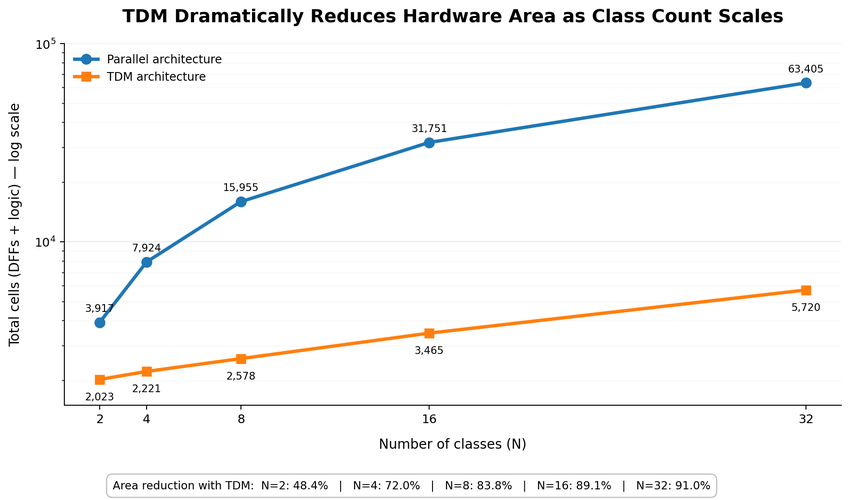
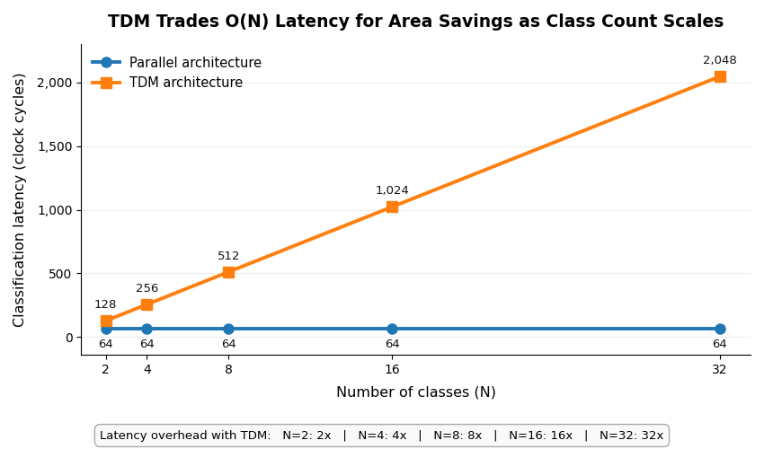

<a id="readme-top"></a>

<!-- PROJECT HEADER -->
<br />
<div align="center">
  <h2 align="center">LIF Spiking Neural Network Pattern Classifier</h2>

  <p align="center">
    A synthesizable Verilog Leaky Integrate-and-Fire (LIF) SNN for 5x5 digit classification, comparing Parallel vs. Time-Multiplexed (TDM) RTL microarchitectures.
    <br />
    <a href="#how-the-network-works"><strong>Explore the architecture »</strong></a>
    <br />
    <br />
    <a href="#verification--waveforms">View Waveforms</a>
    &middot;
    <a href="https://github.com/samarth1011-1/lif-snn-classifer/issues/new?labels=bug">Report Bug</a>
    &middot;
    <a href="https://github.com/samarth1011-1/lif-snn-classifer/issues/new?labels=enhancement">Request Feature</a>
  </p>
</div>

<!-- TABLE OF CONTENTS -->
<details>
  <summary>Table of Contents</summary>
  <ol>
    <li>
      <a href="#about-the-project">About The Project</a>
      <ul>
        <li><a href="#built-with">Built With</a></li>
      </ul>
    </li>
    <li><a href="#how-the-network-works">How the Network Works</a></li>
    <li><a href="#parallel-vs-tdm-synthesis-results">Parallel vs. TDM Synthesis Results</a></li>
    <li><a href="#verification--waveforms">Verification &amp; Waveforms</a></li>
    <li>
      <a href="#getting-started">Getting Started</a>
      <ul>
        <li><a href="#prerequisites">Prerequisites</a></li>
        <li><a href="#running-simulation--synthesis">Running Simulation &amp; Synthesis</a></li>
      </ul>
    </li>
    <li><a href="#project-files">Project Files</a></li>
  </ol>
</details>

<!-- ABOUT THE PROJECT -->
## About The Project

This project implements a Leaky Integrate-and-Fire (LIF) Spiking Neural Network (SNN) in synthesizable Verilog that classifies 5x5 binary digit patterns (`0` to `3`) and rejects invalid inputs like all-ones frames.

The core goal is to quantify the hardware area vs. throughput trade-off between two RTL microarchitectures for the exact same network:

* **Parallel (`snn_top_parallel.v`)**: instantiates one dedicated MAC and LIF neuron per class. Evaluates all classes every clock and finishes in **64 cycles** regardless of class count, but area grows linearly with `N`.
* **Time-Multiplexed / TDM (`snn_top_tdm.v`)**: shares one MAC and one combinational LIF core across all `N` classes round-robin, storing neuron states in centralized register arrays. Keeps compute area flat while trading off latency (`N * 64` cycles).

A bit-accurate Python golden model (`model/lif_neuron.py`) is included to verify both RTL designs down to the exact spike count. Currently targeting digits `0` to `3`, the architecture is parameterized so it can be scaled up to `0-10`, `0-50`, and `0-100` classes in future iterations—which is why characterizing the TDM area-vs.-latency trade-off is central to the design.

<p align="right">(<a href="#readme-top">back to top</a>)</p>

### Built With

* [![Verilog][Verilog-badge]][Verilog-url]
* [![Python][Python-badge]][Python-url]
* [![Icarus Verilog][Icarus-badge]][Icarus-url]
* [![Yosys][Yosys-badge]][Yosys-url]

<p align="right">(<a href="#readme-top">back to top</a>)</p>

<!-- ARCHITECTURE -->
## How the Network Works

Each 5x5 input frame is flattened into a 25-bit vector and evaluated over a 64-step observation window per neuron:

1. **Weight MAC (`weight_mac.v`)**: A combinational 25-input signed adder tree multiplies active input pixels against each class template. Matching pixels get `W_ON = +16` and non-matching pixels get `W_OFF = -32`. Stronger negative weights suppress false spikes on oversized or all-ones patterns. Negative sums clamp to `0` and positive sums saturate at `0xFFFF`.
2. **LIF Neuron (`lif_neuron.v` / inlined in `snn_top_tdm.v`)**: Every step, membrane voltage leaks using ceiling shift division `leak = (v_mem + 2^K - 1) >> K` (`K = 5`), ensuring small non-zero voltages still drain to `0` instead of stalling. Synaptic current is added with 16-bit unsigned saturation. When `v_mem >= V_TH` (`384`), the neuron emits a 1-cycle spike and resets to `0`.
3. **Decision Logic (`spike_counter.v` / argmax in `snn_top_tdm.v`)**: Spikes are counted per class across 64 steps per neuron. An argmax comparator picks the class with the highest spike count (lowest index wins ties) and pulses `result_valid`. If no neuron spikes, the pattern is rejected.

### Parallel Architecture (`snn_top_parallel.v`)
![Parallel Architecture][parallel-arch]

### Time-Multiplexed Architecture (`snn_top_tdm.v`)
![TDM Architecture][tdm-arch]

<p align="right">(<a href="#readme-top">back to top</a>)</p>

<!-- SYNTHESIS RESULTS -->
## Parallel vs. TDM Synthesis Results

Both architectures were synthesized with Yosys (generic cell mapping) across `NUM_CLASSES` = 2, 4, 8, 16, and 32:

| N (Classes) | Parallel Cells (DFFs / Logic) | TDM Cells (DFFs / Logic) | Area Reduction | Latency (Par / TDM) |
| :---: | :---: | :---: | :---: | :---: |
| **2** | 3,917 (58 / 3,859) | 2,023 (46 / 1,977) | 1.94x (48.4%) | 64 / 128 cycles |
| **4** | 7,924 (108 / 7,816) | 2,221 (84 / 2,137) | 3.57x (72.0%) | 64 / 256 cycles |
| **8** | 15,955 (208 / 15,747) | 2,578 (158 / 2,420) | 6.19x (83.8%) | 64 / 512 cycles |
| **16** | 31,751 (408 / 31,343) | 3,465 (304 / 3,161) | 9.16x (89.1%) | 64 / 1024 cycles |
| **32** | 63,405 (808 / 62,597) | 5,720 (594 / 5,126) | 11.08x (91.0%) | 64 / 2048 cycles |

Key takeaways from the sweep:
* **Compute scaling**: Parallel logic grows linearly at ~1,950 gates per neuron because the 25-input MAC adder tree is duplicated `N` times (62,597 logic gates at `N=32`). TDM keeps the compute core constant (`O(1)`), so the growth from `N=2` to `N=32` only comes from the weight ROM mux and argmax comparator (**12.2x fewer logic gates** at `N=32`).
* **Registers**: Parallel uses `25*N + 8` DFFs. TDM moves neuron state out into centralized `vmem_state` and `spike_counts` register arrays, using `18*N + 18` DFFs.
* **Latency**: Parallel evaluates all neurons every clock (64 cycles total). TDM evaluates 1 neuron per clock (`N * 64` cycles total).

### Area &amp; Latency Scaling

<p align="center">
  
</p>

<p align="center">
  
</p>

<p align="right">(<a href="#readme-top">back to top</a>)</p>

<!-- VERIFICATION & WAVEFORMS -->
## Verification &amp; Waveforms

Both Verilog testbenches and `model/lif_neuron.py` match bit-for-bit across all 6 test cases:

| Test Case | Parallel Spikes `[n0, n1, n2, n3]` | TDM Spikes `[n0, n1, n2, n3]` | Result |
| :--- | :---: | :---: | :---: |
| Digit 0 | `[22, 0, 0, 0]` | `[21, 0, 0, 0]` | Class 0 |
| Digit 1 | `[0, 16, 0, 0]` | `[0, 16, 0, 0]` | Class 1 |
| Digit 2 | `[0, 0, 32, 9]` | `[0, 0, 32, 9]` | Class 2 |
| Digit 3 | `[4, 0, 16, 22]` | `[4, 0, 16, 21]` | Class 3 |
| Noisy Digit 2 (2 bit flips) | `[0, 0, 22, 9]` | `[0, 0, 21, 9]` | Class 2 |
| All-Ones Input | `[0, 0, 0, 0]` | `[0, 0, 0, 0]` | Rejected |

*(Note: TDM counts for digits 0, 3, and noisy 2 are 1 spike lower than parallel because the parallel testbench applies the input 2 cycles before `classify_start`, whereas TDM resets state on `classify_start`.)*

### Parallel (`snn_parallel_tb.v`)
64 cycles per classification (~1.28 us per test), multiple neurons can fire on the same clock cycle:

![Parallel Waveform][parallel-wave]

### TDM (`snn_tdm_tb.v`)
256 cycles per classification (~5.12 us per test), at most one neuron fires per cycle in round-robin order while producing the exact same `predicted_class`:

![TDM Waveform][tdm-wave]

<p align="right">(<a href="#readme-top">back to top</a>)</p>

<!-- GETTING STARTED -->
## Getting Started

### Prerequisites

* **Icarus Verilog** (`iverilog` / `vvp`) and **Tcl** (`tclsh`) for RTL simulation
* **GTKWave** (optional) for viewing `.vcd` waveforms
* **Python 3** for running the golden reference model
* **Yosys** for running the synthesis sweeps

### Running Simulation &amp; Synthesis

1. Clone the repo
   ```sh
   git clone https://github.com/samarth1011-1/lif-snn-classifer.git
   cd lif-snn-classifer
   ```

2. Run Parallel &amp; TDM RTL simulations
   ```sh
   # Parallel simulation
   tclsh scripts/run_parallel.tcl
   gtkwave sim/snn_parallel_tb.vcd

   # TDM simulation
   tclsh scripts/run_tdm.tcl
   gtkwave sim/snn_tdm_tb.vcd
   ```

3. Run the Python golden model
   ```sh
   python model/lif_neuron.py
   ```

4. Run Yosys synthesis sweeps (`N = 2, 4, 8, 16, 32`)
   ```sh
   yosys -c scripts/sweep_parallel.tcl
   yosys -c scripts/sweep_tdm.tcl
   ```

### Testing a Custom 5x5 Digit

You can test any custom 5x5 pattern by editing the `CUSTOM` bitmap (`1` = ON, `0` = OFF) at the top of `tb/custom_input_tb.v`:

```verilog
localparam [24:0] CUSTOM = {
    5'b01110, // row 4 (top)
    5'b10001, // row 3
    5'b10001, // row 2
    5'b10001, // row 1
    5'b01110  // row 0 (bottom)
};
```

Then compile and run it to print the per-neuron spike histogram and predicted class:

```sh
iverilog -g2012 -o sim/output_custom rtl/lif_neuron.v rtl/weight_mac.v rtl/spike_counter.v rtl/snn_top_parallel.v tb/custom_input_tb.v
vvp sim/output_custom
```

<p align="right">(<a href="#readme-top">back to top</a>)</p>

<!-- PROJECT FILES -->
## Project Files

* `rtl/lif_neuron.v` - Sequential LIF neuron module used by the parallel top
* `rtl/lif_neuron_comb.v` - Standalone combinational LIF core (reference)
* `rtl/weight_mac.v` - 25-input signed saturating MAC
* `rtl/spike_counter.v` - 64-cycle spike accumulator and argmax
* `rtl/snn_top_parallel.v` - Parallel N-neuron top module
* `rtl/snn_top_tdm.v` - Time-multiplexed N-neuron top module
* `tb/snn_parallel_tb.v` - Parallel regression testbench
* `tb/snn_tdm_tb.v` - TDM regression testbench
* `tb/custom_input_tb.v` - Interactive testbench for arbitrary 5x5 patterns
* `model/lif_neuron.py` - Bit-accurate Python reference for both Parallel and TDM
* `scripts/run_parallel.tcl`, `scripts/run_tdm.tcl` - Tcl scripts to compile and run simulations
* `scripts/sweep_parallel.tcl`, `scripts/sweep_tdm.tcl` - Yosys synthesis sweep scripts

<p align="right">(<a href="#readme-top">back to top</a>)</p>

<!-- MARKDOWN LINKS & IMAGES -->
[parallel-arch]: docs/parallel_arch.png
[tdm-arch]: docs/tdm_arch.png
[parallel-wave]: docs/waveforms/Parallel.png
[tdm-wave]: docs/waveforms/TDM.png
[Verilog-badge]: https://img.shields.io/badge/Verilog-HDL-00599C?style=for-the-badge
[Verilog-url]: https://en.wikipedia.org/wiki/Verilog
[Python-badge]: https://img.shields.io/badge/Python-3776AB?style=for-the-badge&logo=python&logoColor=white
[Python-url]: https://www.python.org/
[Icarus-badge]: https://img.shields.io/badge/Icarus_Verilog-Simulation-2E8B57?style=for-the-badge
[Icarus-url]: https://steveicarus.github.io/iverilog/
[Yosys-badge]: https://img.shields.io/badge/Yosys-Synthesis-8A2BE2?style=for-the-badge
[Yosys-url]: https://yosyshq.net/yosys/
